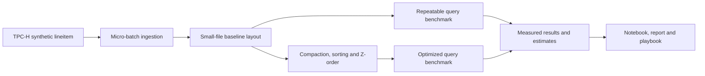

# Small Files, Compaction and Energy

Big Data Systems and Responsible AI Engineering project by Akash Kiran Vernekar (PES1UG24AM338) and Anish A Kunder (PES1UG24AM343).

## Project status

The baseline query harness is implemented for local Parquet layouts. Small-file generation and ingestion are tracked in separate issue PRs; compaction and optimized layouts remain follow-up work.

## Planned architecture



This is a custom local workload, not an official TPC-H benchmark result.

## Setup and checks

Use Python 3.12 and install the direct dependencies:

```powershell
python -m pip install duckdb==2.0.0
python -m unittest discover -s tests -v
```

## Run the baseline query benchmark

```powershell
python scripts\benchmark_queries.py --input .\data\small-files-100rows-issue4 --output .\data\benchmark-baseline.json --warmups 1 --repeats 5 --threads 4
```

The input can be one Parquet file or a directory tree of Parquet files with the TPC-H lineitem columns. The output JSON contains raw run timings, result rows and hashes, input/file statistics, and local system details. See [the benchmark protocol](docs/benchmark-protocol.md) for the workload and timing assumptions. The output must be new so an earlier raw result cannot be overwritten.

## Project deliverables

- Reproducible generation, ingestion, layout and benchmark scripts
- Results notebook with actual before-and-after measurements
- Tuning playbook and 3–5 page technical report
- Data card and measured governance evidence
- Three-minute in-class demo