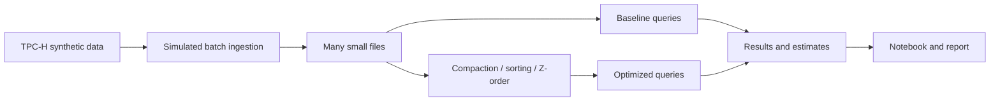

# Small Files, Compaction and Energy

Big Data Systems and Responsible AI Engineering project by Akash Kiran Vernekar (PES1UG24AM338) and Anish A Kunder (PES1UG24AM343).

## Project status

Parquet micro-batch replay for creating small files is implemented. Query benchmarks, compaction, sorting, Z-order comparisons, measured energy estimates and final deliverables remain project work.

## Planned architecture



The storage engine and its Z-order support remain to be selected and validated on Windows. This is a custom experiment, not an official TPC-H benchmark.

## Setup and checks

Use Python 3.12. Install the test dependency and run the unit tests:

```powershell
python -m pip install duckdb==2.0.0
python -m unittest discover -s tests -v
```

## Simulate small-file micro-batch ingestion

After a Parquet source is available, replay it in small batches:

```powershell
python scripts\ingest_small_files.py --input .\data\tpch-sf001\lineitem.parquet --output .\data\small-files-100rows --batch-rows 100
```

The script writes one Parquet file per batch and records row counts, schema, file sizes, checksums and source/output fingerprints in `ingestion-manifest.json`. It rejects a non-empty output directory and verifies that all source rows are represented. This is controlled micro-batch replay, not a live stream. At scale factor 0.001 and 100 rows per batch, the sample produces 61 files; report the measured count rather than extrapolating to millions.

## Planned deliverables

- Reproducible data generation, ingestion, tuning and benchmark scripts
- Results notebook and measured before/after results
- Tuning playbook and 3–5 page technical report
- Data card and evidence for a responsible AI component
- Three-minute in-class demo

No query-performance, energy or privacy guarantees are claimed at this stage.