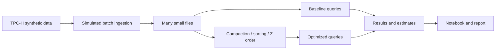

# Small Files, Compaction and Energy

Big Data Systems and Responsible AI Engineering project by Akash Kiran Vernekar (PES1UG24AM338) and Anish A Kunder (PES1UG24AM343).

## Project status

A reproducible TPC-H lineitem generator is implemented. Streaming-style ingestion, storage tuning, query benchmarks, energy estimates, the results notebook, technical report and demo remain project work.

## Planned architecture



The storage engine and its Z-order support remain to be selected and validated on Windows. This is a custom experiment, not an official TPC-H benchmark.

## Setup and checks

Use Python 3.12. Install the generator dependency and run the tests:

```powershell
python -m pip install duckdb==2.0.0
python -m unittest discover -s tests -v
```

## Generate TPC-H lineitem

```powershell
python scripts\generate_tpch.py --scale-factor 0.001 --output .\data\tpch-sf001
```

The command creates `lineitem.parquet` and `manifest.json`. Scale factor 0.001 produces 6,005 rows. The generator refuses to overwrite a non-empty output directory. Review [the data card](docs/data-card.md) for provenance, limitations, and applicable terms before redistributing data.

## Planned deliverables

- Reproducible ingestion, tuning and benchmark scripts
- Results notebook with measured before-and-after comparisons
- Tuning playbook and 3–5 page technical report
- Data card and measured governance evidence
- Three-minute in-class demo