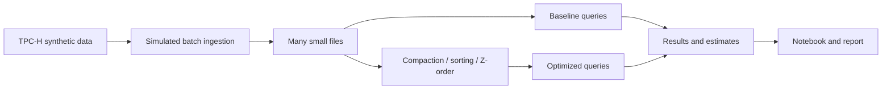

# Small Files, Compaction and Energy

Big Data Systems and Responsible AI Engineering project by Akash Kiran Vernekar (PES1UG24AM338) and Anish A Kunder (PES1UG24AM343).

## Project status

Initial project structure. The TPC-H data generator, simulated ingestion, storage optimizations, benchmarks, energy estimates, and final deliverables are not implemented yet.

## Planned architecture



Local Spark and Delta Lake are the current candidate stack; the full experiment remains to be implemented and validated. This will be a custom experiment, not an official TPC-H benchmark.

## Windows setup and checks

This is an initial local setup, not yet a complete reproducible experiment. Git, Python 3.12, and Java 17 are required for the proposed Spark/Delta setup. Direct Python dependencies are listed in `requirements.txt`; a small local compaction and Z-order smoke test has passed, but the complete experiment still needs validation.

### Existing D: setup on Akash's laptop

Use the project checkout at `D:\BDSRE-Mini-Project` for day-to-day work. The separate tools and virtual environment are in `D:\BDSRE-Tools`. The former Desktop copy has been removed.

In PowerShell, run this in each new session:

```powershell
. D:\BDSRE-Tools\activate-project.ps1
python --version
python -m pip check
python -m unittest discover -s tests -v
```

The helper is machine-specific and lives on D:, not in this repository. It sets Java, Python and temporary/cache paths for that session and changes to the D: checkout. If PowerShell blocks the helper, run `Set-ExecutionPolicy -Scope Process Bypass` in that session before the first command. This does not change the permanent execution policy.

Installed and smoke-tested locally: Python 3.12.10, Java 17, package imports, a basic Spark job, Delta table write/read, compaction and Z-order. A 400-row smoke test reduced four active files to one and preserved the row count and ID sum. This is a functional check, not a performance benchmark. DuckDB TPC-H generation also passed at scale factor 0.001 (6,005 lineitem rows), using an extension cache on D:. The full experiment still needs end-to-end validation. The local activation helper puts the cached Delta jars on the Java classpath to avoid a Windows Spark temporary-jar locking issue; Spark code must still configure the Delta SQL extension and catalog. Do not additionally call configure_spark_with_delta_pip in that local setup, since it may reintroduce the copied-jar cleanup warning. The helper requires the jar files in its configured D: cache.

### Set up another Windows computer

Install Git, Python 3.12, and a Java 17 JDK. From a PowerShell terminal in the project checkout:

```powershell
py -3.12 -m venv .venv
.\.venv\Scripts\python.exe -m pip install -r requirements.txt
.\.venv\Scripts\python.exe -m pip check
.\.venv\Scripts\python.exe -m unittest discover -s tests -v
```

If `py` is unavailable, use the full path to a Python 3.12 executable. Set `JAVA_HOME` to the JDK directory for Spark. Delta's Java dependencies need network access on their first use. If you require all project data and caches on a specific drive, configure the environment's temporary, pip, Jupyter, Spark/Ivy and Java cache paths for that drive; package installation alone does not guarantee every program uses that drive.

The virtual environment and generated data are excluded from Git. Full pipeline commands and pinned transitive dependencies will be added after the experiment is implemented and validated.

## Planned deliverables

- Reproducible data generation, ingestion, tuning and benchmark scripts
- Results notebook and measured before/after results
- Tuning playbook and 3–5 page technical report
- Data card and evidence for a responsible AI component
- Three-minute in-class demo

No measurements or privacy guarantees are claimed at this stage.
