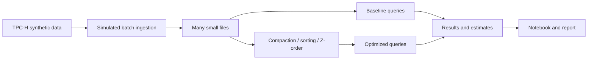

# Small Files, Compaction and Energy

Big Data Systems and Responsible AI Engineering project by Akash Kiran Vernekar (PES1UG24AM338) and Anish A Kunder (PES1UG24AM343).

## Project status

The Windows toolchain is reproducible and has a working smoke test. The full TPC-H ingestion and query benchmark pipeline, measured comparisons, notebook, report and demo remain project work.

## Planned architecture



The experiment uses local DuckDB for TPC-H generation and Spark with Delta Lake for table operations. Results are from a custom workload and are not official TPC-H benchmark results.

## Windows setup

Prerequisites: Git, Python 3.12, and a Java 17 JDK. Open PowerShell in the repository root and choose a tools directory on the desired drive. The script keeps its virtual environment, temporary files, and package cache under `ToolsRoot`.

```powershell
.\scripts\setup-windows.ps1 -ProjectRoot (Get-Location).Path -ToolsRoot 'D:\BDSRE-Tools'
. 'D:\BDSRE-Tools\venv\Scripts\Activate.ps1'
$env:BDSRE_TOOLS_ROOT = 'D:\BDSRE-Tools'
python -m unittest discover -s tests -v
python scripts\smoke_test.py
```

The setup script checks the Python and Java versions, installs the pinned direct dependencies from `requirements.txt`, and runs `pip check`. It sets per-session Spark, Jupyter, Python and temporary paths. Use the same PowerShell session for subsequent commands. Dependency downloads and Delta's first use require network access. The initial Spark setup may print routine JVM startup messages.

### Smoke test coverage

The smoke test generates TPC-H lineitem data at scale factor 0.001 and checks its expected 6,005 rows. It then writes a synthetic Delta table in four batches, applies compaction and Z-ordering, and checks that row count and ID sum are unchanged and compaction reduces active files. It is a functional setup check, not a performance benchmark.

On the tested Windows setup, Spark 3.5.7 / Delta Lake 3.3.2 prints a shutdown warning when it cannot delete a temporary copy of a JAR that the JVM still has open. The smoke test exits successfully; data checks pass. This known Windows file-lock behavior does not indicate a failed compaction or Z-order operation. Keep temporary and Ivy cache paths on the tools drive. See [Spark issue SPARK-50628](https://issues.apache.org/jira/browse/SPARK-50628).

### Existing D: setup

Akash's current checkout is `D:\BDSRE-Mini-Project`; its local tools and virtual environment are in `D:\BDSRE-Tools`. In a new PowerShell window, run the local helper, which configures paths for this machine:

```powershell
. D:\BDSRE-Tools\activate-project.ps1
python -m unittest discover -s tests -v
python scripts\smoke_test.py
```

That helper is machine-specific and is not needed on another computer. The checked-in `scripts/setup-windows.ps1` is the teammate setup path.

## Planned deliverables

- Reproducible data generation, ingestion, tuning and benchmark scripts
- Results notebook and measured before-and-after results
- Tuning playbook and 3–5 page technical report
- Data card and measured evidence for a responsible AI component
- Three-minute in-class demo

No project performance results or privacy guarantees are claimed at this stage.
