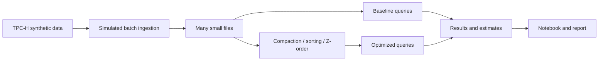

# Small Files, Compaction and Energy

Big Data Systems and Responsible AI Engineering project by Akash Kiran Vernekar (PES1UG24AM338) and Anish A Kunder (PES1UG24AM343).

## Project status

Initial project structure. The TPC-H data generator, simulated ingestion, storage optimizations, benchmarks, energy estimates, and final deliverables are not implemented yet.

## Planned architecture



The storage engine and its Z-order support remain to be selected and validated on Windows. This will be a custom experiment, not an official TPC-H benchmark.

## Setup and checks

Install Python 3.11 or later. From the project root run:

```powershell
python -m unittest discover -s tests -v
```

The initial checks use only the Python standard library. Instructions for the data pipeline will be added when it exists.

## Planned deliverables

- Reproducible data generation, ingestion, tuning and benchmark scripts
- [Results notebook](notebooks/results_analysis.ipynb) and reproducible before/after comparisons
- Tuning playbook and 3–5 page technical report
- Data card and evidence for a responsible AI component
- Three-minute in-class demo

See [notebook instructions](notebooks/README.md). Generated benchmark and governance JSON stays in the ignored `data/` directory; regenerate it with the documented commands before running the notebook. No energy/power measurements or privacy guarantees are claimed.
