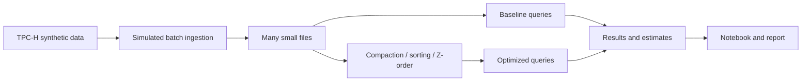

# Small Files, Compaction and Energy

Big Data Systems and Responsible AI Engineering project by Akash Kiran Vernekar (PES1UG24AM338) and Anish A Kunder (PES1UG24AM343).

## Project status

Parquet micro-batch replay for creating small files is implemented. Query benchmarks, compaction, sorting, Z-order comparisons, measured energy estimates and final deliverables remain project work.

## Planned architecture



The storage engine and its Z-order support remain to be selected and validated on Windows. This is a custom experiment, not an official TPC-H benchmark.

## Setup and checks

Use Python 3.12. Install the test dependency and run the unit tests:

```powershell
python -m pip install duckdb==2.0.0
python -m unittest discover -s tests -v
```

## Simulate small-file micro-batch ingestion

After a Parquet source is available, replay it in small batches:

```powershell
<<<<<<< HEAD
python scripts\ingest_small_files.py --input .\data\tpch-sf001-issue3\lineitem.parquet --output .\data\small-files-100rows-issue4 --batch-rows 100
```

The script writes one Parquet file per batch and records row counts, schema, file sizes, checksums and source/output fingerprints in `ingestion-manifest.json`. It rejects a non-empty output directory and verifies that all source rows are represented. This is controlled micro-batch replay, not a live stream. At scale factor 0.001 and 100 rows per batch, the sample produces 61 files; report the measured count rather than extrapolating to millions.
=======
python scripts\generate_tpch.py --scale-factor 0.001 --output .\data\tpch-sf001-issue3
```

The command produces `lineitem.parquet` using Zstandard compression and `manifest.json` with the generator version, scale, validated row count and schema, intended use, privacy note and file SHA-256. Scale factor 0.001 creates 6,005 rows. The output directory must be absent or empty; the generator refuses to overwrite existing files. Choose a larger scale factor only after estimating your disk capacity. Review [the data card](docs/data-card.md) for provenance, generator limitations, and TPC-H terms before redistributing data.

## Simulate streaming micro-batch ingestion

```powershell
python scripts\ingest_small_files.py --input .\data\tpch-sf001-issue3\lineitem.parquet --output .\data\small-files-100rows-issue4-issue4 --batch-rows 100
```

This replays the Parquet rows as sequential micro-batches and writes one Parquet file per batch. It is a controlled simulation, not a live stream. The output `ingestion-manifest.json` records the chosen batch size, row count, schema, number of files, per-file bytes and SHA-256, and aggregate size statistics. Before reporting success, the script compares source and output row counts, schema, and order-independent row fingerprints. The output folder must be empty or new so previous results cannot be silently overwritten.

At scale factor 0.001 with 100 rows per batch, expect 61 files (60 batches of 100 rows and a final batch of 5). File counts and sizes are measured in the manifest; this does not claim millions of files. See `scripts/README.md` and `docs/tuning-playbook.md` for details.
## Smoke test

```powershell
python scripts\smoke_test.py
```

This checks a small TPC-H generation and Delta table write, compaction and Z-ordering. It is a functional setup check, not a performance benchmark. On Windows Spark can print a known temporary JAR cleanup warning at shutdown even when the test exits successfully; details are in the data card and Issue #2.
>>>>>>> b528d21 (Use project-local paths for generated data)

## Planned deliverables

- Reproducible data generation, ingestion, tuning and benchmark scripts
- Results notebook and measured before/after results
- Tuning playbook and 3–5 page technical report
- Data card and evidence for a responsible AI component
- Three-minute in-class demo

No query-performance, energy or privacy guarantees are claimed at this stage.