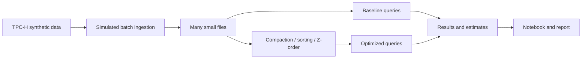

# Small Files, Compaction and Energy

Big Data Systems and Responsible AI Engineering project by Akash Kiran Vernekar (PES1UG24AM338) and Anish A Kunder (PES1UG24AM343).

## Project status

The project includes synthetic TPC-H lineitem generation and small-file ingestion, query benchmarks, compaction, sorted and custom Morton-key layout comparisons, plus transparent energy and electricity-cost estimation from benchmark timings. Results are generated locally and are not committed as project data.

## Planned architecture



DuckDB is the local analytical engine. It has no native Z-order table-layout command, so the experiment uses an explicit custom Morton-key ordering over `l_shipdate` and `l_returnflag`; it is not an official TPC-H benchmark.

## Setup and checks

Install Python 3.11 or later and DuckDB 2.0.0 in the project virtual environment. From the project root run:

```powershell
python -m unittest discover -s tests -v
```

For energy estimates, supply explicit assumed whole-system watts and a hypothetical electricity tariff. Neither is measured by the project.

```powershell
python scripts/estimate_energy_cost.py `
  --input data/layout-variants-issue7.json `
  --output data/energy-estimates-issue8.json `
  --assumed-system-watts 50 `
  --electricity-rate-inr-per-kwh 8
```

Replace the example 50 W and ₹8/kWh scenario inputs with values your report can justify. The estimator records direct cash project spend separately (defaults to the team's reported ₹0) and includes optimization energy and per-query break-even calculations. See [the tuning playbook](docs/tuning-playbook.md).

## Planned deliverables

- Reproducible data generation, ingestion, tuning and benchmark scripts
- Results notebook and measured before/after results
- Tuning playbook and 3–5 page technical report
- Data card and evidence for a responsible AI component
- Three-minute in-class demo

No measurements or privacy guarantees are claimed at this stage.
