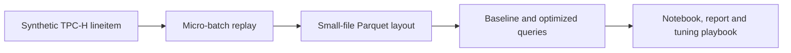

# Small Files, Compaction and Energy

Big Data Systems and Responsible AI Engineering project by Akash Kiran Vernekar (PES1UG24AM338) and Anish A Kunder (PES1UG24AM343).

## Project status

This issue implements sequential micro-batch replay of synthetic TPC-H lineitem Parquet data. It creates small files and writes an ingestion manifest with file sizes, checksums, schema, row counts, and source/output fingerprints. This is a controlled streaming simulation, not a live stream.

## Architecture



The project is a custom local workload, not an official TPC-H benchmark. It uses generated benchmark data and does not use real personal records.

## Setup and checks

Use Python 3.12. Install the pinned DuckDB dependency and run tests:

```powershell
python -m pip install duckdb==2.0.0
python -m unittest discover -s tests -v
```

## Generate and replay the data

Generate the lineitem source with the project generator:

```powershell
python scripts\generate_tpch.py --scale-factor 0.001 --output .\data\tpch-sf001-issue3
```

Replay it in batches of 100 rows:

```powershell
python scripts\ingest_small_files.py --input .\data\tpch-sf001-issue3\lineitem.parquet --output .\data\small-files-100rows-issue4 --batch-rows 100
```

The scale 0.001 sample contains 6,005 rows and produces 61 batches at 100 rows per batch. The script refuses to overwrite a non-empty output directory, checks row count, schema and row fingerprints, and writes `ingestion-manifest.json` with each file's byte size and SHA-256. Report the measured file count; do not extrapolate it to millions of files.

See [the tuning playbook](docs/tuning-playbook.md) and [script guide](scripts/README.md) for evidence and limitations. The replay is not a live streaming system.

## Deliverables

- Reproducible data generation, ingestion, layout and benchmark scripts
- Results notebook with before-and-after measurements
- Tuning playbook and technical report
- Data card and measured governance evidence
- Three-minute in-class demo

No production-scale, measured-power, or privacy guarantees are claimed.
