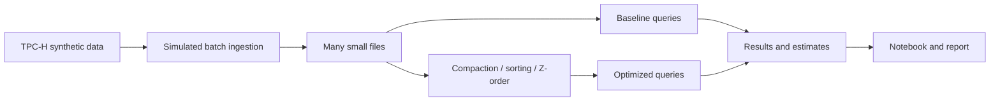

# Small Files, Compaction and Energy

Big Data Systems and Responsible AI Engineering project by Akash Kiran Vernekar (PES1UG24AM338) and Anish A Kunder (PES1UG24AM343).

## Project status

The project implements synthetic TPC-H lineitem generation and small-file ingestion, query benchmarking, compaction, and Issue #7 layout experiments (sorted and custom Morton-ordered layouts). Energy and cost estimation is the next implementation step. No results are claimed until a reproducible run produces them.

## Planned architecture



DuckDB is the local analytical engine. It has no native Z-order table-layout command, so the experiment implements an explicit custom 2D Morton-key ordering over `l_shipdate` and `l_returnflag`; this is not advertised as a native DuckDB Z-order feature. This is a custom experiment, not an official TPC-H benchmark.

## Setup and checks

Install Python 3.11 or later and DuckDB 2.0.0 in the project virtual environment. From the project root run:

```powershell
python -m unittest discover -s tests -v
```

Generate or ingest the synthetic lineitem data using the existing pipeline scripts, then run the layout comparison against its Parquet output:

```powershell
python scripts/layout_variants.py `
  --input data/small-files-100rows-issue4 `
  --output-root data/layout-variants-issue7 `
  --results data/layout-variants-issue7.json `
  --file-size-bytes 262144 --warmups 1 --repeats 5 --threads 4
```

The output root and results JSON must be new paths. The script preserves its source and records the baseline plus compacted, sorted, and Morton-ordered layouts, actual file sizes, repeated query timings, optimization time, and equivalence checks. See [the tuning playbook](docs/tuning-playbook.md) for interpretation and limitations.

## Planned deliverables

- Reproducible data generation, ingestion, tuning and benchmark scripts
- Results notebook and measured before/after results
- Tuning playbook and 3–5 page technical report
- Data card and evidence for a responsible AI component
- Three-minute in-class demo

No measurements or privacy guarantees are claimed at this stage.
