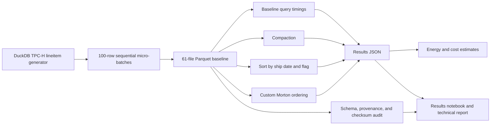

# Small Files, Compaction and Energy

**Big Data Systems and Responsible AI Engineering** project by Akash Kiran Vernekar (PES1UG24AM338) and Anish A Kunder (PES1UG24AM343).

This project measures how many small Parquet files affect local query latency and compares compaction, sorting, and a custom two-column Morton ordering. It also reports transparent, assumption-based energy estimates and a narrow data-governance audit. The run is deliberately small enough for a Windows laptop; it is not a distributed-scale benchmark or live streaming system.

## Architecture



DuckDB runs the local Parquet queries. Its TPC-H extension generates the synthetic `lineitem` sample. DuckDB does not provide native Z-ordering here: the Morton variant interleaves keys for `l_shipdate` and `l_returnflag` and is described as a custom ordering. The study is derived from TPC-H and is not comparable to official TPC-H benchmark results.

## Prerequisites and Windows setup

- Windows 11, Git, Python 3.12, and Java 17 (the setup smoke test uses Spark and Delta Lake).
- About 1 GB free disk space for the sample and layout variants.
- Network access for the first dependency install and the DuckDB TPC-H extension download.

The setup script puts the virtual environment, caches, and temporary Spark files under a separate tools directory. From the repository root in PowerShell:

```powershell
$Tools = 'D:\BDSRE-Tools'
.\scripts\setup-windows.ps1 -ProjectRoot (Get-Location).Path -ToolsRoot $Tools
& "$Tools\venv\Scripts\Activate.ps1"
python --version
python -m pip check
python -m unittest discover -s tests -v
python scripts\smoke_test.py
```

Choose a different `ToolsRoot` if needed. Keep it outside the repository. The Spark smoke test checks data integrity and compaction/Z-order operations; it configures Delta through the Delta Python package. The benchmark pipeline below uses DuckDB and Parquet.

## Reproduce the experiment

Run these commands from the repository root using the activated environment. Repeating these commands refreshes the generated artifacts at the same paths after each stage succeeds; save a separate copy first if you need to retain earlier results.

```powershell
python scripts\generate_tpch.py --scale-factor 0.001 --output data\tpch-sf001-issue3
python scripts\ingest_small_files.py --input data\tpch-sf001-issue3\lineitem.parquet --output data\small-files-100rows-issue4 --batch-rows 100
python scripts\benchmark_queries.py --input data\small-files-100rows-issue4 --output data\benchmark-baseline.json --warmups 1 --repeats 5 --threads 4
python scripts\layout_variants.py --input data\small-files-100rows-issue4 --output-root data\layout-variants-issue7 --results data\layout-variants-issue7.json --file-size-bytes 262144 --warmups 1 --repeats 5 --threads 4
python scripts\estimate_energy_cost.py --input data\layout-variants-issue7.json --output data\energy-estimates-issue8.json --assumed-system-watts 50 --electricity-rate-inr-per-kwh 8
python scripts\governance_check.py --input data\small-files-100rows-issue4 --provenance data\tpch-sf001-issue3\manifest.json --output data\governance-issue9.json
python -m pip install -r requirements-notebook.txt
python -m nbconvert --to notebook --execute notebooks\results_analysis.ipynb --output results_analysis.executed.ipynb --output-dir data
```

The sample is expected to contain 6,005 rows and the 100-row replay should create 61 Parquet files (60 batches of 100 rows and a final batch of 5). Use the generated manifests and result JSON as the authority for each run. The notebook checks query-result hashes, benchmark/energy timing consistency, and the governance audit before presenting its analysis.

To run the Spark/Delta environment check separately, use `python scripts\smoke_test.py`. To inspect individual script options, pass `--help`. The simpler compaction-only command is `scripts\compact_parquet.py`; the side-by-side `layout_variants.py` command above records compacted, sorted, and custom Morton layouts in one comparison.

## Deliverables and evidence

- Reproducible scripts: `scripts/`.
- Unit tests and single Python 3.12 CI workflow: `tests/` and `.github/workflows/ci.yml`.
- Results notebook: `notebooks/results_analysis.ipynb`.
- 3-page technical report: `reports/technical-report.docx`.
- Data card and tuning playbook: `docs/data-card.md` and `docs/tuning-playbook.md`.
- 180-second demo video with disclosed computer-generated narration, editable slide deck, and timed script: `presentations/`.

Generated Parquet data, raw JSON, executed notebooks, and virtual environments are excluded from Git. The generator and commands above recreate them. Review the data card for TPC-derived data terms and intended use. The governance audit validates a schema allowlist, provenance, row totals, and checksums; it does not prove that all values are non-sensitive, quantify re-identification risk, or provide a privacy guarantee. No AI model is trained or deployed, so model fairness and model behavior were not evaluated.

## Results and limits

The recorded local run used 6,005 rows, 61 baseline files, one warm-up and five measured repeats per query, DuckDB 2.0.0, Python 3.12, and four query threads. Results and one-time layout costs are in `docs/tuning-playbook.md`. Energy uses an assumed 50 W average system draw and an illustrative INR 8/kWh tariff; no power meter was used. Direct project cash spending was reported as INR 0. The measurements reflect warm local file access, not a cluster, cold-cache behavior, or millions of files.
