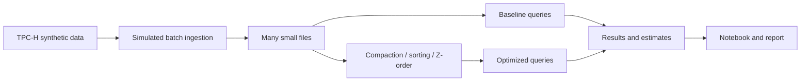

# Small Files, Compaction and Energy

Big Data Systems and Responsible AI Engineering project by Akash Kiran Vernekar (PES1UG24AM338) and Anish A Kunder (PES1UG24AM343).

## Project status

Initial project structure. The TPC-H data generator, simulated ingestion, storage optimizations, benchmarks, energy estimates, and final deliverables are not implemented yet.

## Planned architecture



The storage engine and its Z-order support remain to be selected and validated on Windows. This will be a custom experiment, not an official TPC-H benchmark.

## Setup and checks

Install Python 3.11 or later. From the project root run:

```powershell
python -m unittest discover -s tests -v
```

The initial checks use only the Python standard library. Instructions for the data pipeline will be added when it exists.

## Narrow data-governance check

The governance checker validates the TPC-H `lineitem` column allowlist, generator provenance fields, observed row count and optional micro-batch manifest checksums. After generating and optionally micro-batching data, run:

```powershell
python scripts/governance_check.py `
  --input data/small-files-100rows-issue4 `
  --provenance data/tpch-sf001-issue3/manifest.json `
  --output data/governance-issue9.json
```

The checker discovers `ingestion-manifest.json` in the input directory. A nonzero exit means a check failed; the audit JSON is still written so failures are inspectable. This allowlist detects unexpected field names. It does not prove that values contain no personal information or quantify re-identification risk; see the data card.

## Planned deliverables

- Reproducible data generation, ingestion, tuning and benchmark scripts
- Results notebook and measured before/after results
- Tuning playbook and 3–5 page technical report
- Data card and evidence for a responsible AI component
- Three-minute in-class demo

No measurements or privacy guarantees are claimed at this stage.
