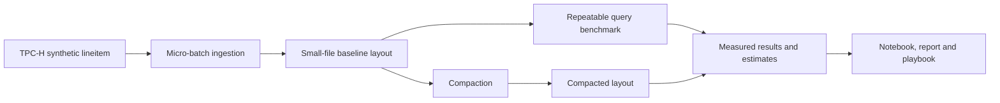

# Small Files, Compaction and Energy

Big Data Systems and Responsible AI Engineering project by Akash Kiran Vernekar (PES1UG24AM338) and Anish A Kunder (PES1UG24AM343).

## Project status

The compaction command is implemented for Parquet layouts and verifies row and query-result preservation. Sorting and Z-order layouts, energy/cost estimates, notebook, report and governance evidence remain project work.

## Architecture



This is a custom local workload, not an official TPC-H benchmark result.

## Setup and checks

Use Python 3.12 and install the direct dependencies:

```powershell
python -m pip install duckdb==2.0.0
python -m unittest discover -s tests -v
```

## Compact and compare

```powershell
python scripts\compact_parquet.py --input .\data\small-files-100rows-issue4 --output .\data\compacted-256k --results .\data\compaction-256k.json --file-size-bytes 262144 --warmups 1 --repeats 5 --threads 4
```

The baseline is preserved. The command records its file layout and raw query timings, writes a separate compacted layout with an approximate file-size target, validates schema/rows/query outputs, and records compaction duration and post-compaction timings. Read [the compaction playbook](docs/compaction-playbook.md) for cache conditions and limitations.

## Project deliverables

- Reproducible generation, ingestion, layout and benchmark scripts
- Results notebook with actual before-and-after measurements
- Tuning playbook and 3–5 page technical report
- Data card and measured governance evidence
- Three-minute in-class demo