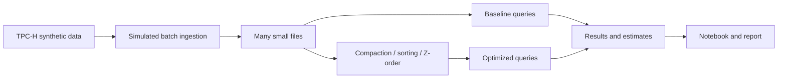

# Small Files, Compaction and Energy

Big Data Systems and Responsible AI Engineering project by Akash Kiran Vernekar (PES1UG24AM338) and Anish A Kunder (PES1UG24AM343).

## Project status

Initial project structure. The TPC-H data generator, simulated ingestion, storage optimizations, benchmarks, energy estimates, and final deliverables are not implemented yet.

## Planned architecture



The storage engine and its Z-order support remain to be selected and validated on Windows. This will be a custom experiment, not an official TPC-H benchmark.

## Setup and checks

Install Python 3.11 or 3.12 and Git. In PowerShell, from the project root, create and use a virtual environment:

```powershell
py -3.12 -m venv .venv
.\.venv\Scripts\python.exe -m unittest discover -s tests -v
```

If the Python launcher `py` is unavailable, replace `py -3.12` with the full path to a Python 3.12 executable. Alternatively, activate the environment using `.\.venv\Scripts\Activate.ps1`, then run `python -m unittest discover -s tests -v`. The environment is local to each computer and is excluded from Git.

The current checks use only the Python standard library. The planned experiment will also require DuckDB, Jupyter, analysis libraries, and compatible PySpark and Delta Lake versions, plus an appropriate Java JDK. These dependencies and their exact versions are not yet pinned by this project. We will add reproducible installation instructions after validating the stack and its Windows compatibility.

## Planned deliverables

- Reproducible data generation, ingestion, tuning and benchmark scripts
- Results notebook and measured before/after results
- Tuning playbook and 3–5 page technical report
- Data card and evidence for a responsible AI component
- Three-minute in-class demo

No measurements or privacy guarantees are claimed at this stage.
